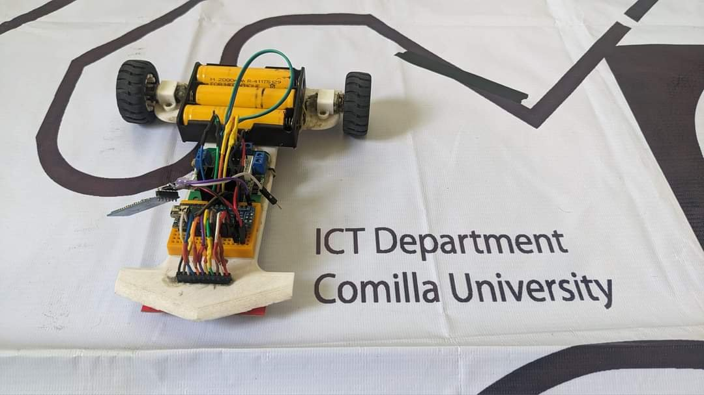
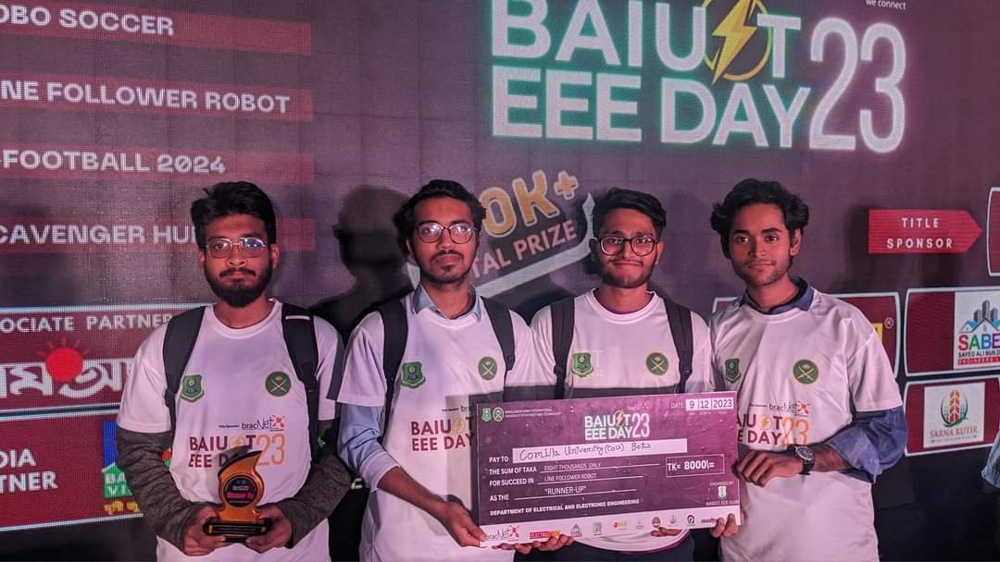
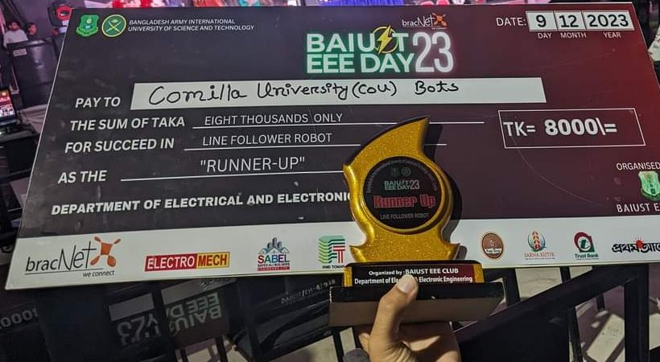
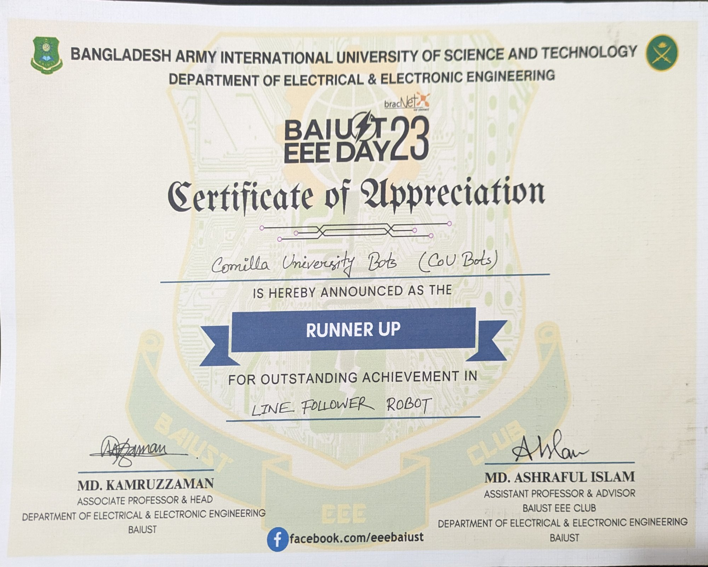

# Line Follower Robot

An Arduino line follower that steers with a PID loop on an eight-sensor QTR
array. Built in 2023; with our team, CoU Bots, it came second in the Line
Follower Robot contest at BAIUST's EEE Day 2023.

## The contest

Our team, Comilla University Bots (CoU Bots), was runner-up in the Line
Follower Robot contest at EEE Day 2023, held by the Bangladesh Army
International University of Science and Technology (BAIUST). The prize
cheque is dated 9 December 2023.

| | | |
|---|---|---|
|  Four of the team at the event with the trophy and the cheque |  The runner-up trophy and the Tk 8,000 prize |  The runner-up certificate ([PDF](docs/line-follower-robot-2023-12-09-certificate.pdf)) |

## How it works

- **Sensing.** An eight-sensor QTR reflectance array, read through
  Pololu's QTRSensors library on analog pins A0 to A7, gives the line's
  position from 0 to 7000. The centre is 3500, so the error is
  3500 minus the position.
- **Steering.** A PID loop turns the error into a correction: the left
  motor runs at the base speed plus the correction, and the right motor at
  the base speed minus it. The base speed is 90 and the cap is 250 (PWM),
  and a negative speed turns a motor backward.
- **Calibration.** At power-up the built-in LED lights while the sensors
  are calibrated (400 calibration passes), then it goes out.
- **Tuning while it runs.** Over serial at 9600 baud, `1` starts the
  robot, `0` stops it, and `kp<value>`, `ki<value>` or `kd<value>` sets a
  gain. The robot starts stopped.

As shipped, the gains are Kp = 0.07, Ki = 0 and Kd = 0, so the robot steers
on the proportional term alone until I and D gains are sent over serial.
The gains used in the contest are not recorded.

| | |
|---|---|
| Board | An Arduino with analog pins A0 to A7, such as a Nano (an Uno has no A6 or A7) |
| Sensors | An eight-sensor QTR analog reflectance array |
| Motors | Two DC motors on a dual H-bridge driver. Left: forward D5, backward D4, speed D10. Right: forward D6, backward D7, speed D11 |

## Repository layout

| Folder | Holds |
|---|---|
| [`firmware/line-follower-robot/`](firmware/line-follower-robot) | The Arduino sketch: [`line-follower-robot.ino`](firmware/line-follower-robot/line-follower-robot.ino) (setup and the main loop), with the calibration, sensor reading, PID control, motor and serial-command tabs |
| [`docs/`](docs) | The certificate as a PDF, and in [`media/`](docs/media) the photos on this page; the originals, as first uploaded, are in `originals/` |

## My part

The robot was raced by our team, CoU Bots, from Comilla University. I
wrote the code in this repository.

It stands on others' work: the sensor setup, the calibration loop and the
line reading follow the QTRAExample of
[Pololu's QTRSensors library](https://github.com/pololu/qtr-sensors-arduino)
(MIT licence).

## Run it

1. In the Arduino IDE, install the **QTRSensors** library by Pololu
   (version 4 or later).
2. Open `firmware/line-follower-robot/line-follower-robot.ino`; the IDE
   opens the other tabs with it.
3. Upload it and open the Serial Monitor at 9600 baud (this restarts the
   board). While the LED is lit, slide the sensors back and forth across the
   line by hand, so each one sees the line and the background. When the LED
   goes out, send `1`.

## Known problems

- After any serial command the sketch waits about a second for more text
  (`readString`'s timeout), and the motors keep their last speed meanwhile.
- The PID's integral is never limited or reset, even by `0` or `1`. It
  keeps adding up while the robot runs, so a Ki above 0 also applies
  everything gathered so far.
- There is no special handling for losing the line or for crossings.

## Licence

My code is under the MIT licence: see [LICENSE](LICENSE). The lines that
follow Pololu's QTRAExample keep Pololu's copyright (Copyright (c)
2008-2019 Pololu Corporation, MIT licence). The QTRSensors library itself is
not included here.
